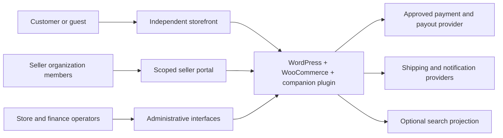
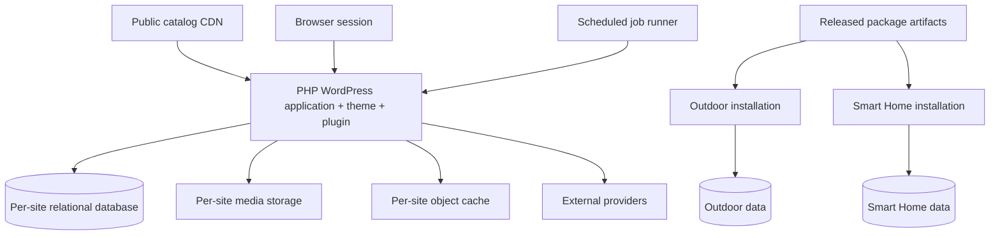
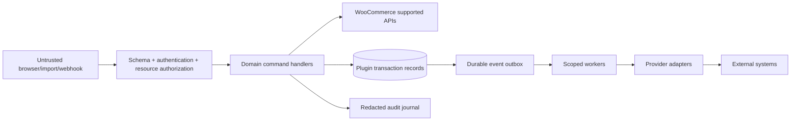

# System views and data flows

Document ID: DOC-D-VIEWS | Title: System views and data flows | Revision: 1.0 | Date: 2026-10-28
Status: drafted; pending human approval and future implementation verification
Owner: Solution/Software Architect | Reviewers: WooCommerce Solution Specialist; QA/Test Engineer; Application Security Engineer
Scope: proposed system design only | Requirements: FR-D001; FR-D004; FR-D005; FR-D009; FR-D010 | ADRs: ADR-02; ADR-07; ADR-08; ADR-09; ADR-14
Dependencies: [requirements](../02-requirements/requirements.csv); [source register](../00-governance/sources.csv)
Assumptions: ASM-01 independent sites; ASM-02 jurisdiction/providers undecided; ASM-03 planning scenarios
Sources: USER-BRIEF sections 2–8; SRC-D001–SRC-D009

## Context view — conceptual



Customers access public data and their own session/order. Seller members access only authorized organization resources. Administrators use separately authorized operations. All providers are outside the store trust boundary; responses require validation and reconciliation.

## Container and deployment view — proposed physical units



The job runner invokes the same application/module contracts; it is not another business service. The two database boxes are not shared tenants. Backups, keys, cache prefixes and domain cookies are isolated. CDN caches only public anonymous variants with explicit locale/currency/region keys.

## Component and trust boundary view



The validation boundary rejects client prices, seller IDs not implied by membership, unsafe uploads and unknown schema fields. Jobs re-check resource identity and job scope; they never inherit an administrator's broad permission merely because that user queued them. Public projections exclude verification documents, addresses, balances and internal risk signals.

## Checkout sequence — conceptual coordination

```mermaid
sequenceDiagram
 actor Buyer
 participant API as Store API extension
 participant Offer as Offer/stock coordinator
 participant WC as WooCommerce CRUD
 participant Pay as Payment adapter
 participant Queue as Journal and jobs
 Buyer->>API: offer + variation + quantity + accepted quote version
 API->>Offer: validate seller, destination, terms and stock
 Offer-->>API: reservation token or conflict
 API->>WC: create pending order and immutable item snapshots
 API->>Queue: persist operation and payment intent key
 API->>Pay: request payment (stable idempotency key)
 Pay-->>Queue: signed success callback, possibly repeated
 Queue->>Offer: commit reserved quantities once
 Queue->>WC: mark verified payment result
 Queue->>Queue: post allocation ledger once; notify
 API-->>Buyer: confirmed or pending; never guessed success
```

FR-D009 requires recoverable intermediate states at every boundary. If the order save succeeds but the journal acknowledgement fails, recovery locates the order by operation key. A callback arrives only after durable receipt and signature validation. If the reservation expired before late capture, reconciliation attempts fresh acquisition; if unavailable, the order enters exception handling and an idempotent refund is requested. No new seller is substituted.

## Data minimization and threat review

FR-D010 partitions public catalog, session cart, customer PII, seller operational data, finance and secrets. Payment card data is confined to the selected hosted/tokenized provider path pending qualified scope review. Provider credentials never enter exports, logs or browser payloads. Seller exports reveal only assigned item/shipment contact fields, not another seller's lines or full customer history. Threat-model reviewers trace each arrow against the [security specification](../11-security-privacy/security-requirements-and-threat-model.md).
