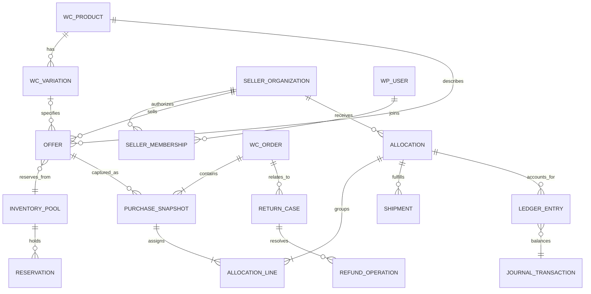

# Domain model and ERD

Document ID: DOC-D-DOMAIN | Title: Domain model and ERD | Revision: 1.0 | Date: 2026-10-28
Status: drafted; pending human approval and future verification
Owner: Database/Data Architect | Reviewers: Marketplace Solution Architect; WooCommerce Extension Developer; QA/Test Engineer
Scope: logical data and future implementation contracts | Requirements: FR-D018–FR-D020; FR-D025; FR-D032 | ADRs: ADR-05; ADR-08; ADR-10
Dependencies: [requirements](../02-requirements/requirements.csv); [architecture](../03-architecture/architecture-overview.md)
Assumptions: ASM-01; ASM-02; ASM-03 | Sources: USER-BRIEF sections 7–8; [source register](../00-governance/sources.csv)

## Canonical relationships

This is a conceptual ERD, not a proposal for one table per box. A native first-party offer is a facade over a WooCommerce product/variation until marketplace migration. Product IDs and variation IDs remain native positive integer identities; an offer never becomes a substitute product identity. Parent/variation matching is validated on the server. An offer can target a simple product or one exact variation; an active variable-product parent does not represent a purchasable variation.

## Identity rules

| Domain ID | Meaning and uniqueness | Stable linkage |
|---|---|---|
| DATA-D01 Product | `(site_id, wc_product_id)` | Native content/URL identity survives marketplace migration |
| DATA-D02 Variation | `(site_id, wc_variation_id)` plus parent | Unique native option combination; unavailable choices stay distinct |
| DATA-D03 Seller | Site-local UUID; first-party seller has explicit kind | Organization persists after owner/user changes |
| DATA-D04 Membership | `(seller_id, wp_user_id)` unique active membership | Roles grant scoped capabilities; multiple memberships allowed |
| DATA-D05 Offer | Site-local UUID | Seller, exact product/variation, condition and origin; revisions preserve ID |
| DATA-D06 Inventory | UUID pool + authority mode/epoch | Multiple approved offers may share one seller pool explicitly |
| DATA-D07 Reservation | UUID + operation/line key | Held quantity, expiry, terminal transition and version |
| DATA-D08 Snapshot | WC order/item IDs + snapshot version | Immutable purchased commercial terms |
| DATA-D09 Allocation | UUID and unique order/seller/fulfillment grouping | Lines reference exact purchased items/components |
| DATA-D10 Journal | UUID + `(provider, external_event_id)` or command key | Balanced entries and reversal references |
| DATA-D11 Compatibility evidence | UUID + claim subject/target/version scope | Provenance, dates, reviewer, confidence, revocation |
| DATA-D12 Provider mapping | `(site, provider, external_kind, external_id)` unique | Canonical ID, mapping confidence and reviewer |

## Complex products

Grouped products are navigation containers; selected child products create separately validated lines. Bundles/composites record a configuration digest and component graph: parent presentation plus payable/component amounts whose sum equals charged totals. A component cannot be returned twice or create a second stock decrement. Subscription signup records a contract and renewal linkage; each renewal has its own order, quote, stock/financial effects and policy snapshot. Booking records include resource, timezone, interval, persons and provider reservation identity; time availability is not generic stock. Unknown product types have an explicit unavailable-purchase state until a descriptor and adapter exist.

## Governance and deletion

Canonical matching uses authoritative identifiers and reviewed evidence. A similar title is not enough to merge. Vendor-owned unique listings retain native identity and original content. Merging confirmed duplicates creates an alias/redirect and provider map while preserving historical snapshots; splitting a mistaken merge restores distinct identities with an audit record. No seller can rewrite the purchased seller or technical identity of old orders. FR-D018–FR-D020 are verified with duplicate/conflict fixtures, membership transfer and same-variation multiple-offer purchase cases.
