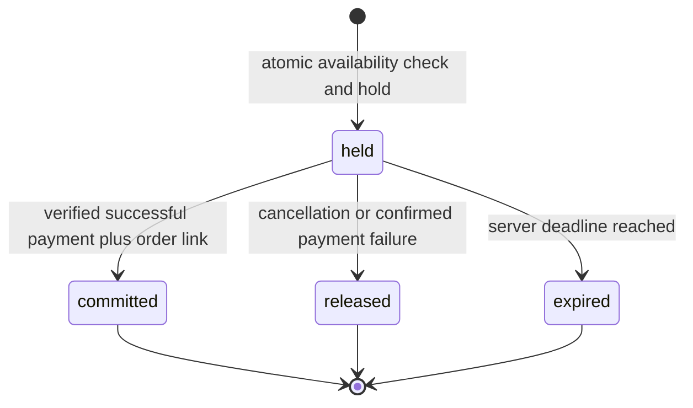

# Offers, inventory and reservations

Document ID: DOC-D-INVENTORY | Title: Offers, inventory and reservations | Revision: 1.0 | Date: 2026-10-28
Status: drafted; pending human approval and future verification
Owner: Database/Data Architect | Reviewers: Marketplace Solution Architect; WooCommerce Extension Developer; QA/Test Engineer
Scope: logical data and future implementation contracts | Requirements: FR-D021–FR-D024; FR-D052; FR-D053 | ADRs: ADR-05; ADR-07; ADR-10
Dependencies: [requirements](../02-requirements/requirements.csv); [architecture](../03-architecture/architecture-overview.md)
Assumptions: ASM-01; ASM-02; ASM-03 | Sources: USER-BRIEF sections 7–8; [source register](../00-governance/sources.csv)

## One authority per product and pool

`authority_mode=native_wc` delegates price/stock operations to WooCommerce through `wc-native-v1`. The first-party offer facade resolves current native values and has no separate editable stock. `authority_mode=marketplace_plugin` makes offer price and inventory pools authoritative; WooCommerce product price may be a public display projection, while native managed stock remains a zero-stock non-purchasable shell; actual offer inventory is never copied as saleable native stock. A migration epoch fences obsolete writers. Mapped offer lines are excluded from native/provider stock decrement/restock. Failure to prove that suppression blocks marketplace activation.

A pool belongs to exactly one seller and fulfillment origin. Its physical `on_hand` excludes quantities already committed to sold orders; `reserved` counts unexpired held quantities. Available physical quantity is on_hand − reserved. All marketplace backorders and preorders are blocked in the baseline; backorder_limit is fixed at zero. A future adapter requires a separately specified backorder-demand/debt allocation model and verification before this limit can change. It cannot subtract unreceived units from nonnegative physical on_hand. A native variable product may use parent stock only if its descriptor says so; marketplace variations may share one explicit seller pool, never an inferred parent total across sellers.

## Offer eligibility and price

An active offer requires approved seller, reviewed product/variation match, valid price/currency, supported destination/product capability, published terms, permitted condition and available quantity. Nullable prices are allowed in draft or non-purchasable types only; zero is a valid free price subject to policy. Quote calculations are server-owned. The cart stores offer ID/version and last accepted commercial digest. Any price, seller, warranty, fulfillment or material terms change requires reconfirmation; the UI shows the old/new values. No silent seller replacement is allowed. Decreased prices may be presented as a new quote but still have a new digest.

## Reservation state machine

The proposed hold TTL is 15 minutes, capped at 30 minutes after one audited payment-challenge extension. Browser refresh cannot extend it. `operation_key + line_key` uniquely identifies the hold; duplicate acquisition returns the same result. Acquisition locks/compares the pool version and updates reserved atomically, so competing last-unit requests have one winner. Commit decreases on_hand and reserved once. Release/expiry decreases reserved only once. Returns create an independent inspected-restock operation; a financial refund does not automatically restock a damaged or missing item.

## Checkout and asynchronous failures

Add-to-cart checks validity but does not promise long-term stock. Cart updates revalidate quantity and offer version. Final checkout acquires holds in deterministic pool order, then releases the entire attempted group if a required line fails. Payment is requested only after order and operation references are durable. A payment timeout remains unknown until provider query/reconciliation; it is not treated as definitive failure. When a late successful callback arrives after expiry, attempt a new hold under current stock; if unavailable, set paid_stock_exception as a separate operational flag, retain payment captured, place the WooCommerce order on-hold and request an idempotent refund with customer notice. Never oversell to hide an integration race.

## Suspension, cache and operational tests

Suspension before reservation or before charge blocks new checkout and releases holds where no payment can still succeed; unknown payments remain reconciled. Suspension after confirmed purchase retains shipment/refund/support duties. Offer changes invalidate public summaries; public offer-projection cache TTL is at most 15 seconds proposed, while checkout always bypasses it. Tests include 20 simultaneous last-unit requests, duplicate commit/release, expired hold plus late capture, cross-seller stock update denial, parent-pool sharing, seller suspension at each stage and exactly one inspected restock. FR-D052 requires every stock delta to reference an operation, actor and authority epoch; FR-D053 requires drift reports to quarantine affected pools until reconciled.

## Persisted fail-closed native fallback

Marketplace-mapped products and each purchasable variation retain a native WooCommerce non-purchasable shell: managed native stock zero, backorders disabled, and no independently saleable native inventory. The active verified adapter supplies offer eligibility/availability through supported integration points. Native prices may support display projections, but native stock is not a saleable copy of offer inventory. This persists even when the companion plugin is forcibly unavailable. FR-D076 requires direct native add-to-cart, cart update and checkout, including carts created before plugin loss, to reject marketplace shells. UI hiding alone is insufficient. Exact integration behavior must be proven on the pinned WooCommerce release before activation.

An independent host/operator health path can put affected commerce into maintenance on dependency loss; it must not depend entirely on the failed plugin. Native-mode products remain ordinary native WooCommerce products. Abrupt plugin deletion cannot itself run cleanup or refund workers: restore the signed package or use the documented operator/provider reconciliation lane to fulfill existing obligations. The design does not claim deactivation hooks can recover a physically missing runtime.

The independent dependency-loss guard is a mandatory marketplace activation gate. If the plugin is fully absent it cannot intercept native refund/restock/admin actions. The external health/maintenance mechanism therefore stops affected purchase and native stock-mutating recovery paths before such operations proceed; if reliable product isolation is unavailable, suspend all checkout while retaining browse/support. Legacy-order refunds after cutover must disable native restock and route inspected stock adjustments through the epoch-aware pool adapter. During abrupt loss, operators use the approved provider money lane and defer stock operations until restoration. Future evidence must include legacy refund/restock attempts after cutover and forced dependency loss, followed by direct cart/checkout attempts. A zero-stock shell alone is not sufficient protection from later native stock mutation.
