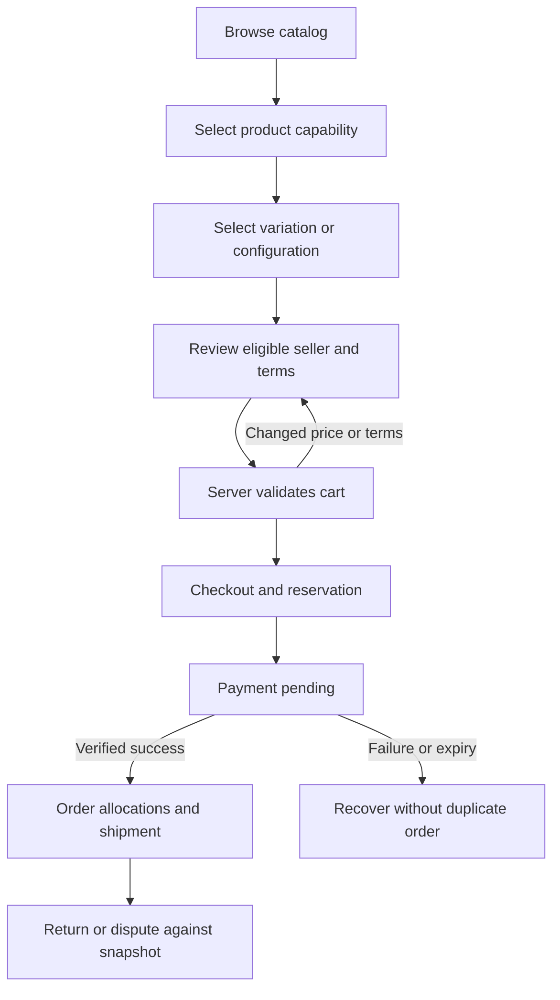

# Journeys, task flows and textual wireframes

Document ID: DOC-U-09 | Revision: 1.0 | Date: 2026-10-28
Status: drafted; pending human approval | Owner: UI/Visual Designer
Reviewers: Accessibility Specialist; Frontend Engineer; Content Designer
Scope: shared storefront and customer/seller presentation contracts
Requirements: FR-U005; FR-U006; FR-U007; FR-U008; FR-U017 | ADRs: ADR-01; ADR-04; ADR-12; ADR-15
Dependencies: [tokens](design-system-and-tokens.md); [settings](settings-inventory.csv); [interaction rules](responsive-rtl-and-interactions.md)
Assumptions: ASM-01; ASM-02 | Sources: USER-BRIEF sections 6 and 9; [source register](../00-governance/sources.csv)

## End-to-end task frames

FR-U005–U008 govern the journeys. These are proposed textual wireframes, not built prototypes. The screen/component catalogs own field and state contracts; each flow keeps product, seller, payment and fulfillment states separate.

### Outdoor variable product

SCR-U003 category → SCR-U007 variable PDP → SCR-U014 cart → SCR-U015 checkout → SCR-U016 confirmation → SCR-U021 order → SCR-U022 return. At the PDP: breadcrumb; gallery; product title; verified weight/fit and manual; size fieldset; eligible seller offers; selected offer price/warranty/delivery; quantity; purchase; specifications/reviews/related accessories. Missing size disables purchase with “Choose size”. A seller change requires an explicit action and refreshed quote. Return selects purchased variation and allocation snapshot, not current catalog labels. TEST-U005/U006/U007 covers this path together with financial tests.

### Smart home compatibility and service

SCR-U006 or U011 PDP → compatibility panel CMP-U016 → configuration CMP-U017 → cart. Show region/voltage/model/firmware conditions and evidence review date before “Compatible” wording. A required hub appears as a requirement with an explicit add choice, not a hidden mandatory surcharge. Optional installation starts unselected and shows territory, provider, scheduling and cancellation terms. An unknown combination is labelled unknown; unsupported marketplace bundle configurations remain nonpurchasable. Component return constraints are disclosed before commit.

### Seller lifecycle

SCR-U030 onboarding → application pending → reviewed verification → SCR-U031 dashboard → SCR-U032 canonical match/submission → offer pending moderation → published → SCR-U033 allocation fulfillment → SCR-U034 finance → dispute/hold → suspension. A seller catalog manager cannot approve the same listing or mark a payout settled. When suspended after sale, obligation screens remain reachable with limited capabilities. Public seller visibility and private obligation access are separate policies.

### Returning customer and generic third store

Guest saved list → login → explicit list merge confirmation → account wishlist. Merge deduplicates canonical product plus variation/configuration identity; no price/stock snapshot is treated as current. A third store imports only profile/style configuration, previews missing dependencies, maps categories and selects modules before publishing. Theme-only fallback uses normal WooCommerce pages; plugin with unrelated compatible theme presents semantic forms/tables. No cross-site identity or customer list is copied.

Text description: the flow loops back to explicit offer review whenever commercial terms change. Payment pending is not fulfillment authorization. Returns reference immutable purchased details.

## Failure and abandonment handoffs

A failed facet request retains existing results; an invalid variant retains other valid selections; a cart quote conflict returns to review; a payment timeout shows pending with a safe status refresh. The user can abandon without a fabricated order-success state. Reservation expiry, payment reconciliation and refund handling belong to transaction services, not UI timers. Customer support sees correlation and authorized order allocation, not secrets, card data or another seller's details.

## Future usability evaluation

Use the [prototype validation plan](design-handoff-and-prototype-validation.md) for task scripts. Document drop-off and comprehension hypotheses, not measured conversion rates. Every journey requires localized errors, keyboard completion, seller clarity and recovery proof before implementation acceptance.
