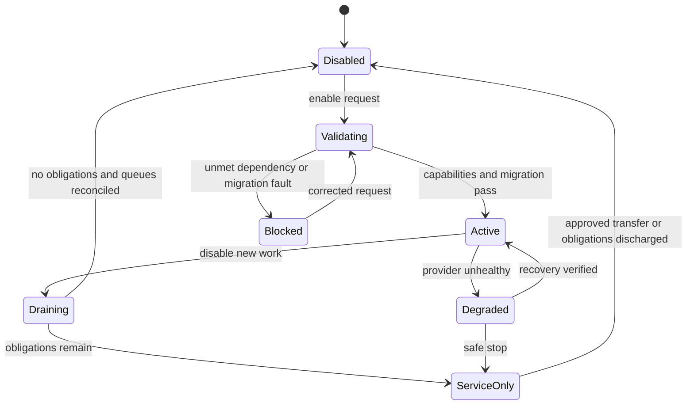

# Plugin kernel and module lifecycle

Document ID: DOC-U-15 | Revision: 1.0 | Date: 2026-10-28
Status: drafted; pending human approval | Owner: WordPress Plugin/PHP Developer
Reviewers: WooCommerce Extension Developer; Application Security Engineer; QA/Test Engineer
Scope: proposed reusable modular commerce plugin, independent sites
Requirements: FR-U026; FR-U021 | ADRs: ADR-02; ADR-03; ADR-04; ADR-07; ADR-16
Dependencies: [module catalog](module-catalog.csv); [domain model](../04-data/domain-model-and-erd.md); [API contract](../09-api-integrations/openapi.yaml)
Assumptions: ASM-01; ASM-02 | Sources: USER-BRIEF sections 5–8; [source register](../00-governance/sources.csv)

## Kernel responsibility (FR-U026)

The proposed companion plugin is a modular monolith, not one service/table per concept. Kernel owns module registry, version/capability negotiation, settings validation, scoped authorization entry points, audit correlation, migrations and job supervision. WordPress remains the content/user/media owner; WooCommerce remains core product/cart/customer-order owner. The kernel does not duplicate their engines. Module data ownership is explicit in [catalog](module-catalog.csv) and individual specs.

A module declaration includes stable key/ID, schema version, capability-provider versions, required modules, optional providers, incompatible configurations, settings schema, authorized commands, job handlers, public UI blocks and obligation-preservation policy. Activation is a server-validated state change by a privileged administrator, not just hiding/showing widgets. Dependencies form an acyclic graph; enabling a dependent module without an available compatible dependency returns a diagnostic with no partial publication.

## Lifecycle state machine

Text description: deactivation first stops new optional work. Financial/fulfillment/notification promises already accepted remain serviceable until discharged or explicitly transferred. A failed activation never announces the module active. Degraded mode identifies available capabilities rather than claiming universal support.

## State invariants and interfaces

Every mutation carries actor/session, active site, object scope and correlation ID. Seller membership is evaluated at execution time, including queued commands. Module feature flags control discovery but never replace authorization. Settings revisions and schema migrations use checkpoints and idempotent steps; background work includes module/version and obligation category. Read-only diagnostics show dependency errors without secrets. Another compatible theme gets semantic plugin forms/tables; enhanced styles are optional.

Native single-merchant price/stock comes from WC. Marketplace offer price/stock comes from the offer inventory adapter; its purchase path disables duplicate WC stock reduction for those managed lines. A cart receives `extensions.commerce` offer reference/version/configuration digest and a server-authoritative quote; no module trusts client prices. Complex provider types require an explicit adapter declaration and tests before marketplace activation.

## Default module contract

Every module spec includes data, permissions, workflows, UI, integrations, concurrency, retention, migration and tests. Unless a spec narrows it: records are site-local; UUID extension IDs are immutable; UTC instants plus display timezone; schema version and author/audit timestamps required; secrets live in approved secret storage; public indexes contain only approved projections. Mutations use optimistic revision checks and idempotency for external effects. Async delivery is at-least-once with deduplication, never exactly-once by assertion.

TEST-U026 includes a dependency cycle, missing provider, concurrent activation, interrupted migration, theme change and attempted seller flag bypass. Expected evidence is unchanged authoritative data on failure and a visible actionable module state. This design is not an activated plugin.
