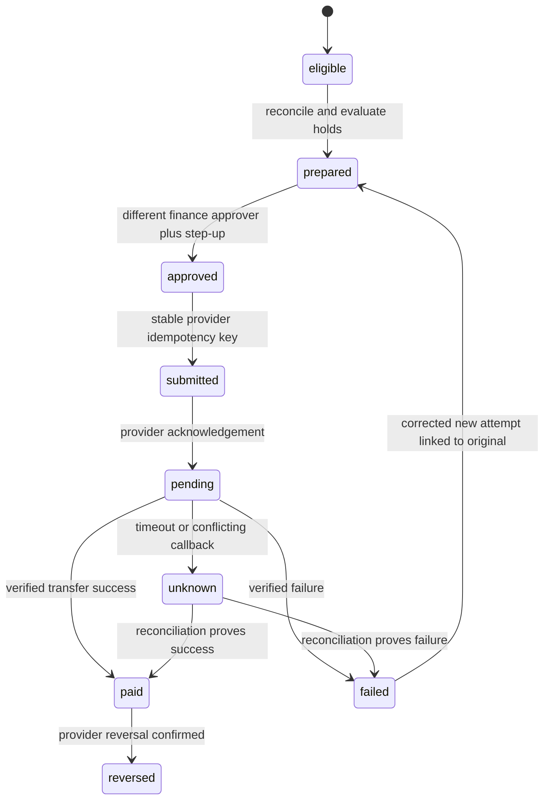

# Commissions, ledger, payouts and reconciliation

Document ID: DOC-D-SETTLEMENT | Title: Commissions, ledger, payouts and reconciliation | Revision: 1.0 | Date: 2026-10-28
Status: drafted; pending business/legal approval and future verification
Owner: Marketplace Solution Architect | Reviewers: Marketplace QA Specialist; Payments/Settlement Engineer; Legal/Compliance Specialist
Scope: future single-merchant and marketplace operations | Requirements: FR-D028–FR-D031; FR-D054; FR-D055; FR-D069; FR-D070 | ADRs: ADR-08; ADR-09; ADR-10
Dependencies: [domain model](../04-data/domain-model-and-erd.md); [requirements](../02-requirements/requirements.csv)
Assumptions: ASM-01; ASM-02; ASM-03 | Sources: USER-BRIEF sections 6–8; [source register](../00-governance/sources.csv)

## Fund-flow boundary and policy

Marketplace activation is blocked until qualified owners approve entity, jurisdictions, merchant/seller of record, taxes, collection, transfer/payout provider, reserves, chargeback liability and contractual disclosure (DEC-01–DEC-04). The plugin records accounting evidence and orchestrates approved provider operations; it does not create an unapproved stored-value wallet or take custody by design assertion. Hosted/tokenized payment is a provisional integration preference, not a conclusion about payment-security scope.

Commission policies are versioned with effective dates, seller/category applicability, basis, rate/fixed fee, tax treatment and promotion funder. Proposed basis for examples is discounted goods net, excluding tax/shipping. Policy precedence is explicit offer contract override → seller contract → platform default, with one resolved version frozen at purchase. A new default affects only new accepted contracts. Renewals follow the subscription agreement and approved adapter, not an unrelated current promotion.

## Seller statement semantics

Statements separate gross sales, seller-funded discounts, taxes held/remitted by the approved party, shipping entitlement, commission, provider fees by liable party, returns, reserves, disputes, available payable, pending transfers, paid and negative balance/receivable. “Available” is calculated from earned ledger balance less holds and pending approved transfers. Pending payout is not counted both as available and paid. Statement opening balance + movements = closing balance by currency. A seller never sees another seller's totals.

## Payout state and controls

Preparers and approvers are different principals. Payout destination change triggers review/hold. A batch snapshots included ledger entries and currency; concurrent preparation cannot include the same entitlement twice. Submission retries use the same idempotency key; a new attempt is allowed only after verified failure and linked reconciliation. A seller suspension/negative balance/dispute can hold new payouts without erasing earned history.

## Reconciliation

At least daily and before every payout batch, compare: WooCommerce paid/refunded orders; gateway captures/refunds/disputes/fees; allocation totals; journal balances; provider transfers/payouts; seller statements. Compare by immutable external reference and currency, not date totals alone. Required result is zero unexplained minor-unit difference and no unmatched successful external money event. Differences enter an owned exception queue, block affected payouts and alert finance; they are never cleared with undocumented balancing adjustments.

An unknown external event is fetched and signature/ownership verified. Missing local effects replay through idempotent commands. Duplicate events are acknowledged without a second posting. Out-of-order events use provider current truth and permitted state transitions; a delayed “pending” cannot revert “paid.” Manual adjustments require reason, evidence, independent approval and immutable reversal links.

## Acceptance and source scope

FR-D069 exercises concurrent batch preparation, unauthorized approval, changed payout destination and provider timeout; FR-D070 reconciles refund-after-payout, chargeback and negative balance without hiding liabilities. Stripe's public separate-charges/transfers index was inspected only for the existence of that integration family; detailed flow/region/liability content could not be fetched, so Stripe is an unverified candidate, not a selected provider. [SRC-D011](https://docs.stripe.com/connect/separate-charges-and-transfers). Full provider contract verification remains DEC-04/09.
