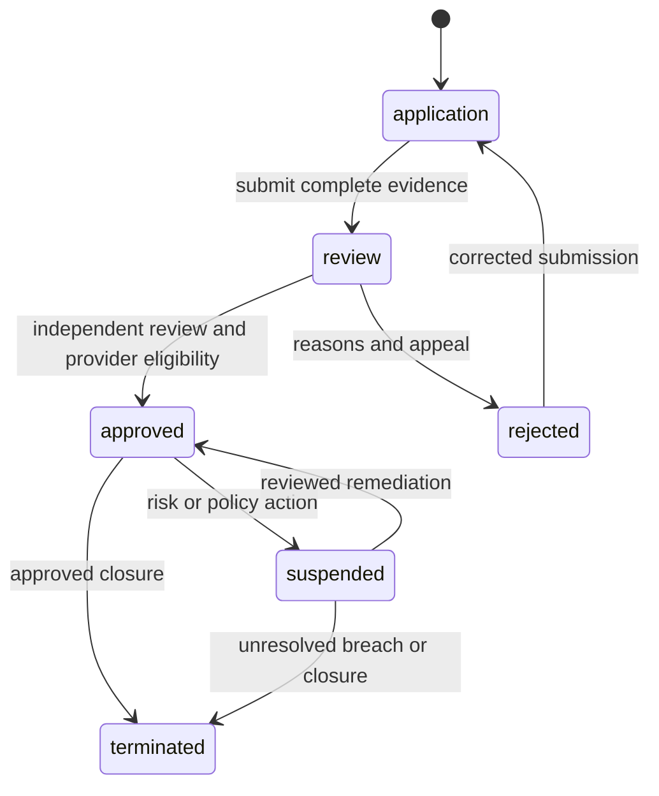

# Seller onboarding, teams and portals

Document ID: DOC-D-SELLERS | Title: Seller onboarding, teams and portals | Revision: 1.0 | Date: 2026-10-28
Status: drafted; pending business/legal approval and future verification
Owner: Marketplace Solution Architect | Reviewers: Marketplace QA Specialist; Payments/Settlement Engineer; Legal/Compliance Specialist
Scope: future single-merchant and marketplace operations | Requirements: FR-D020; FR-D061; FR-D062; FR-D063 | ADRs: ADR-05; ADR-06; ADR-09
Dependencies: [domain model](../04-data/domain-model-and-erd.md); [requirements](../02-requirements/requirements.csv)
Assumptions: ASM-01; ASM-02; ASM-03 | Sources: USER-BRIEF sections 6–8; [source register](../00-governance/sources.csv)

## Seller lifecycle

Application collects minimum business/contact/profile fields and provider-hosted verification reference where feasible. Exact legal identification requirements depend on DEC-01/02. No identity document goes into public WordPress media or search. Verification status is distinct from payout-provider onboarding status. Seller approval requires accepted current terms, reviewed catalog permissions, provider capability and operations readiness; a provider verification callback alone does not publish the store.

## Organizations and membership

A seller organization has one stable UUID and one or more memberships to WordPress users. Owner is a scoped capability set, not a global WordPress administrator. Seller owner can invite/revoke catalog, fulfillment and finance members within the organization; invitation is single-use, expires after 7 days and verifies the target account. Last-owner removal requires verified ownership transfer. Finance membership changes and payout destination changes require step-up and independent platform review with a proposed 24-hour payout hold after destination change, subject to approved policy.

| Application role | Allowed scope | Explicit denial |
|---|---|---|
| Seller owner | Own team/profile/settings; read own operations | Cannot approve own verification, commission or payout |
| Seller catalog manager | Own offer submissions, prices, stock and assets | Cannot change canonical claims or another seller's offers |
| Seller fulfillment manager | Assigned allocations/shipments, minimized delivery contacts | Cannot view unrelated cart lines or financial identity files |
| Seller finance manager | Own statements, payout status, permitted refund requests | Cannot edit ledger or approve own payout |
| Marketplace administrator | Seller operational status and scoped exception handling | Cannot bypass finance dual approval through role label alone |

The full [authorization matrix](../11-security-privacy/roles-capabilities-and-object-authorization.csv) controls REST, exports, media, jobs and reporting equally. Membership revocation invalidates sessions' effective permissions and pending export downloads immediately.

## Portal information architecture and states

Overview shows tasks, own order/offer counts and actionable exceptions; catalog shows moderation reasons and version conflicts; orders show allocation lines and shipment controls; finance shows earned/held/payable/paid/negative amounts separately; team shows membership scope; settings show public branding and approved operational policies. Empty states give specific next actions. Loading does not show stale balances as final. Errors include correlation ID and retry status; permission denied does not disclose another organization's existence. Accessible tables have responsive card/list alternatives and logical RTL alignment.

## Suspension and termination

Suspension removes new offer eligibility, pauses onboarding promotions and stops new payouts according to legal/provider policy; it preserves obligations, statements, support and required refund/fulfillment access. Marketplace operations can assume a constrained operational role with an audit trail when seller access is revoked. Termination requires open orders, returns, disputes, payout liabilities and retention holds to be resolved or transferred under approved terms. FR-D061–FR-D063 cover approval, invitation/revocation, cross-seller denial and suspension during/after purchase.
