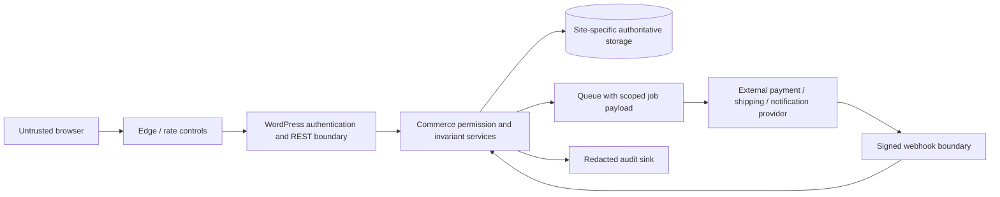

# Security requirements and threat model

Document ID: DOC-S-SEC01 | Revision: 1.0 | Date: 2026-10-28
Status: drafted; pending human approval; implementation verification NOT RUN
Owner: Application Security Engineer | Reviewers: Application Security Engineer; Privacy Specialist; QA/Test Engineer
Scope: Security requirements and threat model | Requirements: SEC-S001; SEC-S002; SEC-S003
ADRs: ADR-03; ADR-09; ADR-14; ADR-16 | Dependencies: [authorization matrix](roles-capabilities-and-object-authorization.csv); [control matrix](controls-and-verification-matrix.csv)
Assumptions: ASM-01; ASM-02 | Sources: USER-BRIEF section11; SRC-S001; SRC-S011–SRC-S013; [source register](../00-governance/sources.csv)

## Assets, actors and trust boundaries

Protected assets are identity sessions, customer addresses/downloads, seller verification documents, offer/inventory authority, order snapshots, settlement evidence, secrets, backups and release artifacts. Actors include guest/customer, seller team members, platform operators, provider services, compromised users/extensions and unauthenticated attackers. WordPress users and seller organizations are separate identities. Independent installations have separate databases, keys, object caches, buckets and service accounts.

Text equivalent: browsers cross edge and application boundaries before touching domain data. Provider callbacks reenter through signature and replay checks. Jobs retain initiating scope and do not become administrator actions. Storage and audit access are separate privileges. This is a conceptual trust/data-flow view, not a deployment claim.

| Threat / entry | Impact and severity | Proposed prevention/detection | Residual risk / accountable owner |
|---|---|---|---|
| Seller changes URL/export ID to another seller | Confidentiality/integrity; critical | Service authorization on resource and fields, query scoping, negative tests | Misconfigured provider adapter; Security Engineer |
| Malicious product/customization/media | Stored XSS, phishing; high | Allowlisted content/URLs, context escaping, quarantine, no seller SVG/CSS | Parser vulnerability; Plugin Developer |
| Forged/replayed payment/refund callback | Duplicate money effects; critical | Verified provider signature, durable event identity, monotonic state transition, ledger reconciliation | Provider outage/ambiguous status; Payments Engineer |
| Race on last unit or discount | Oversell/loss; high | Authoritative atomic claim and immutable calculation; no double decrement | Late capture after expiry; Marketplace Backend Engineer |
| Credential theft / recovery abuse | Privilege takeover; critical | MFA and step-up, rate limits, recovery revocation, audit | Compromised operator workstation; Security Engineer |
| SSRF from connector/media URL | Secret/internal network exposure; high | Approved hosts, resolved-address validation, redirect recheck, egress deny private ranges | Upstream host compromise; API Engineer |
| Import archive/path or decompression attack | Code execution/storage exhaustion; high | No executable imports; size/row/depth limits; staging and preview | Scanner false-negative; Catalog Administrator |
| Cache/search/log/job tenant leakage | Cross-seller/site data; critical | Site/currency/visibility keys; no private shared cache; field minimization | Index ACL bugs; SRE |
| Dependency/update compromise | All assets; critical | Provenance, SBOM, pinned reviewed releases, verified update origin | Trusted maintainer compromise; Release Owner |
| Privacy loss via analytics/retention | Personal data exposure; high | Purpose controls, consent, minimization, erasure workflow | Legal retention conflict; Privacy Specialist |
| Bot reviews/alerts/onboarding | Trust/availability; medium/high | Quotas, moderation, ownership proof, opt-out and anomaly monitoring | False positives; Trust and Safety Specialist |

SEC-S001 requires a reviewed threat/control disposition before each new module or provider crosses a trust boundary. SEC-S002 requires an authorization check on every read/write/export/async action. SEC-S003 requires the project-specific controls mapped in the [matrix](controls-and-verification-matrix.csv) and a full applicability review before implementation release.

The current verified stable [ASVS release](https://asvs.owasp.org/) is5.0.0, published30May2025 (SRC-S001). Proposed baseline is applicable Level2 requirements with stronger finance/admin controls. The selected mapping is not exhaustive ASVS compliance, audit or certification. Customer password-only access is a documented deviation from broad L2 MFA treatment requiring security sign-off; privileged and financial access has no such exception. The [versioned CSV](https://raw.githubusercontent.com/OWASP/ASVS/v5.0.0/5.0/docs_en/OWASP_Application_Security_Verification_Standard_5.0.0_en.csv) supports the referenced control identifiers (SRC-S012).

## Review and acceptance

Every threat records fixture, control owner, future verification evidence and residual risk. Critical/high exploitable authorization, financial integrity, injection or secret exposure blocks release. A scanner pass alone is insufficient: use manual review, isolated integration tests and provider sandbox verification. No live security probing occurred in this assignment.
