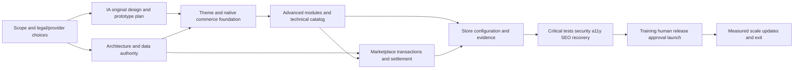

# Phased roadmap and dependencies

Document ID: DOC-G-ROADMAP | Revision: 1.0 | Date: 2026-10-28
Status: drafted | Owner: Project/Program Manager | Reviewers: Product Owner; Solution/Software Architect; QA/Test Engineer; Release/Maintenance Owner
Scope: Phased roadmap and dependencies | Requirements: FR-G009; FR-G016; FR-G019 | ADRs: ADR-02; ADR-06; ADR-14; ADR-16
Dependencies: [requirements](../02-requirements/requirements.csv); [decisions](../00-governance/decisions.csv)
Assumptions: ASM-01; ASM-02; ASM-03 | Sources: USER-BRIEF; [source register](../00-governance/sources.csv)

## Phase gates and release mapping

All ten phases are documented now. P0, P1, P2 and P3 are capability release slices, not substitutes for phases. For example a P0 native-only release still completes applicable store preparation, verification and launch phases; P2 later repeats those gates for marketplace changes. A package whose dependency is irrelevant because its feature is disabled requires an explicit release-slice dependency disposition, never a silent omission.

| Phase / gate | Objectives and entry | Work packages | Exit evidence and accountable function |
|---|---|---|---|
| 1 / GATE-01 | Scope/evidence/business decisions;entry supplied brief | WP-G001–003 | Requirement baseline,decision owners,procurement unknowns;Product Owner |
| 2 / GATE-02 | IA/design/task validation;entry personas and scope | WP-G004–006 | Original tokens/screens/settings,RTL/a11y task evidence;Design System Designer |
| 3 / GATE-03 | Architecture/engineering contracts;entry baseline and designs | WP-G007–009 | ADRs,authority,financial/permission invariants,exact provider gates;Solution/Software Architect |
| 4 / GATE-04 | Native storefront/editor/plugin foundation;entry contracts | WP-G010–012 | Native purchase/fallback/SEO/security/analytics tests;WooCommerce Solution Specialist |
| 5 / GATE-05 | Advanced discovery/customer/catalog features;entry kernel | WP-G013–016 | Per-module capability,consent,error/disable and performance evidence;Product Owner |
| 6 / GATE-06 | Marketplace sellers/transactions/settlement;entry lawful providers and foundation | WP-G017–021 | Org isolation,stock races,ledger conservation,refund/migration evidence;Marketplace Solution Architect |
| 7 / GATE-07 | Both stores and third-site reuse;entry configured components | WP-G022–024 | Catalog provenance,branding/policies,independent settings verified;Store Administrator |
| 8 / GATE-08 | Functional/security/a11y/RTL/SEO/load/recovery verification;entry exact release candidate | WP-G025–027 | Executed results and specialist findings,restore evidence,no critical failures;QA/Test Engineer |
| 9 / GATE-09 | Training/launch/handover;entry all affected gates passed | WP-G028–029 | Human DEC-11,operators,on-call,staged stabilization evidence;Release/Maintenance Owner |
| 10 / GATE-10 | Scale/maintenance/EOL;entry actual operating baselines | WP-G030–032 | Measured improvement,patch/exit/obligation-drain evidence;Release/Maintenance Owner |

## Dependency view

Text alternative: business and provider decisions plus original design feed architecture and foundation; advanced and marketplace capabilities feed store readiness; verified release evidence precedes launch; operations supplies measurements for later optimization. The [dependency register](work-package-dependencies.csv) is the machine-readable detailed graph; [WBS](work-breakdown-structure.csv) owns objectives, owners, risks and acceptance.

## Critical path and staffing risks

The lawful entity/fund-flow decision, exact-version provider capability proof, canonical-offer inventory/ledger design, and refund-after-payout verification can block marketplace activation. UX can proceed on reversible prototypes while those gates are open, but payment promises cannot. Independent specialist capacity for finance/security/accessibility and real product evidence are lead-time dependencies. Catalog preparation can run alongside engineering after schema approval; it cannot supply invented product claims to meet a date.

Security, SEO, accessibility, privacy, analytics and reliability are reviewed in discovery, design, architecture and each feature package. Phase8 gathers final evidence; it is not their first involvement. No deadline or budget is supplied. Estimate after discovery and re-estimate after adapter qualification, using [capacity assumptions](staffing-estimation-and-procurement.md).
